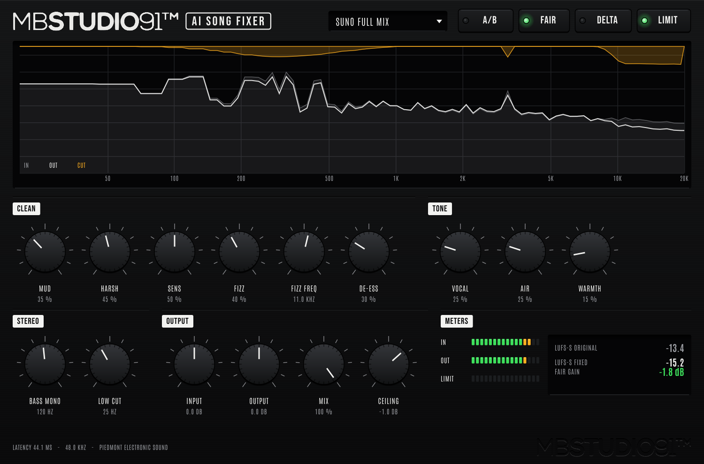

# MBStudio91 AI Song Fixer

Plugin VST3 / AU / Standalone per ripulire i brani generati con Suno, Udio e simili. Si mette sul master (o su uno stem) prima del mastering vero e proprio.



## Cosa fa

Lavora sullo spettro in mid/side, a blocchi di 2048 campioni (4096 a 96 kHz).

| Controllo | Cosa fa |
|---|---|
| MUD | Taglio largo intorno a 300 Hz. Una parte è fissa e leggera, il resto scatta solo quando la zona 150-500 Hz pesa troppo rispetto ai medi (500-2000 Hz). Max circa 5,5 dB. |
| HARSH | Abbassa le risonanze aspre tra 1 e 12 kHz. Interviene solo dove un bin sporge sulla potenza media della sua ottava, quindi le armoniche di voce e strumenti restano dove sono. |
| SENS | Quanto deve sporgere una risonanza perché HARSH la tocchi (da 10 a 2 dB). |
| FIZZ | Il velo metallico e il fruscio in alto. Stima il rumore di fondo per ogni frequenza (minimo su circa 1,5 s) e lo sottrae sopra FIZZ FREQ. Riduce anche il side sulle alte, dove il "luccichio" dell'AI si allarga. |
| FIZZ FREQ | Da dove parte la pulizia del fizz (6-18 kHz). |
| DE-ESS | Smorza 4,5-10 kHz quando le sibilanti prendono troppo spazio sul mid. |
| VOCAL | Presenza della voce al centro, +3 dB massimo a 2,6 kHz solo sul mid. |
| AIR | Un po' d'aria sopra 10 kHz, aggiunta dopo la pulizia del fizz. |
| WARMTH | Saturazione morbida tipo nastro. |
| BASS MONO | Bassi in mono sotto la frequenza scelta (0 = spento). |
| LOW CUT | Passa-alto 12 dB/ottava. |
| INPUT, OUTPUT, MIX | Guadagni e miscela con l'originale. |
| CEILING, LIMIT | Limiter con lookahead di 1,5 ms. Lavora sui campioni, non sui true peak: per la consegna finale tieni il ceiling a -1 dB o metti dopo il tuo limiter true-peak. |

Tasti in alto:

- **A/B** acceso = senti l'originale, spento = senti il pulito. Il passaggio è sfumato, niente click.
- **FAIR** porta l'originale alla stessa loudness del pulito (LUFS short-term), così il confronto è onesto. Il segnale pulito non viene mai toccato da FAIR.
- **DELTA** fa sentire solo quello che la pulizia toglie. Se ci senti dentro la voce o la cassa, stai esagerando.
- **LIMIT** accende o spegne il limiter.

Il display mostra lo spettro in ingresso (grigio), in uscita (bianco) e quanto viene tolto per banda (ambra, in alto). A destra ci sono meter IN/OUT, la riduzione del limiter e le letture LUFS-S dell'originale e del pulito.

## Standalone: lettore e export

Nello Standalone (non nel plugin dentro Ableton) c'è un lettore in basso:

- **LOAD** apre un brano, oppure trascinalo nella finestra. Accetta WAV, AIFF, FLAC e OGG.
- **PLAY / STOP** e **LOOP**. Clic o trascinamento sulla forma d'onda per cambiare punto.
- **A/B, FAIR, DELTA** funzionano anche sul brano caricato: il file prende il posto dell'ingresso e passa per tutta la catena.
- **EXPORT WAV** salva il brano pulito in WAV a 24 bit, alla stessa frequenza del file, con la catena e i valori che vedi a schermo. Esporta da solo in background, con l'avanzamento in percentuale.

Gli MP3 non si leggono ancora: su Suno scarica il brano in WAV. (L'MP3 richiede un'opzione di JUCE con avvertenze di licenza, la attiviamo solo se ti serve davvero.)

## Preset

SUNO FULL MIX (predefinito), SUNO GENTLE, SUNO STRONG, UDIO, VOCAL STEM, INSTRUMENTAL STEM, FLAT (tutto spento, utile per partire da zero).

### Banco PERSONAL

Nel menu dei preset, in fondo, c'è la sezione PERSONAL. Premi **SAVE** per salvare le impostazioni attuali con un nome: se un preset ha già quel nome, viene sostituito. **DEL** elimina il preset personale selezionato, dopo conferma.

I preset personali sono file XML in una cartella del tuo account, separata dal plugin:
- Mac: `~/Library/Application Support/MBStudio91/AI Song Fixer/Presets`
- Windows e Linux: nella cartella dati utente equivalente.

Si possono copiare su un altro computer. Il banco salva i parametri di pulizia e di tono (non la latenza né il limiter).

## Cosa non può fare

Pulisce e lucida, non rigenera. Non ricostruisce dettagli che l'AI non ha generato, non corregge voci che "ondeggiano", note sbagliate o parole mangiate. Per quelle conviene rigenerare o editare la parte in Suno prima.

## Latenza

46 ms circa a 44,1 kHz (2048 + 65 campioni). Il plugin la dichiara all'host, quindi Ableton la compensa da solo. Per il live non è adatto: è pensato per il mix e il mastering.

## Scaricare e installare (Mac)

I file pronti si trovano nella pagina **Releases** del repo, compilati da GitHub Actions a ogni aggiornamento di `main`.

1. Scarica `AISongFixer-macOS-VST3.zip` (e `-AU.zip` se ti serve l'AU).
2. Copia il `.vst3` in `~/Library/Audio/Plug-Ins/VST3/` e il `.component` in `~/Library/Audio/Plug-Ins/Components/`.
3. Il plugin non è firmato da Apple, quindi nel Terminale:
   ```
   xattr -dr com.apple.quarantine ~/Library/Audio/Plug-Ins/VST3/"MBStudio91 AI Song Fixer.vst3"
   xattr -dr com.apple.quarantine ~/Library/Audio/Plug-Ins/Components/"MBStudio91 AI Song Fixer.component"
   ```
4. In Ableton: Preferenze > Plug-ins > Rescan.

Il binario è universale: gira sui Mac Intel (MacBook Pro 2019, Mac mini) e su Apple Silicon, da macOS 11.

## Verifiche fatte

Ogni build su Linux esegue i test offline (`tests/OfflineTest.cpp`) e pluginval al livello 10. A 44,1, 48 e 96 kHz:

- con il preset FLAT l'uscita coincide con l'ingresso ritardato della latenza dichiarata (errore sotto -137 dB);
- su un segnale di prova (accordo, rumore rosa, una risonanza a 3,1 kHz, fruscio e sibilanti) SUNO FULL MIX toglie circa 3,4 dB alla risonanza e circa 3,4 dB di energia sopra 12 kHz, lascia il basso a 110 Hz entro 0,6 dB e abbassa la loudness di meno di 2 LU;
- il limiter tiene il picco a -1,00 dBFS con +9 dB in ingresso;
- con A/B e FAIR l'originale esce entro 0,2 LU dalla loudness del pulito;
- nessun NaN con blocchi di 1, 17, 64, 333 e 1000 campioni;
- export WAV: il file esportato coincide con il sorgente elaborato dalla stessa catena (errore sotto -100 dB), stessa durata e canali;
- CPU: circa il 2% di un core.

Il segnale di prova è sintetico. Su un brano Suno vero conviene partire da SUNO GENTLE, ascoltare in DELTA e salire piano.

## Compilare in locale (facoltativo)

```
cmake -B build -DCMAKE_BUILD_TYPE=Release
cmake --build build --config Release
./build/FixerTests_artefacts/Release/FixerTests
```

JUCE 8.0.4 viene scaricato da CMake (oppure `-DJUCE_DIR=/percorso/JUCE`).

## Riferimenti e licenze

- Idea di partenza: [Suno Fixer di Soundkey](https://soundkey.io/suno-fixer) (meno fango sui medio-bassi, meno fizz in alto, voce più chiara, più aria, confronto alla stessa loudness), pagina letta il 22/11/2026. Il codice di AI Song Fixer è scritto da zero.
- Loudness secondo ITU-R BS.1770 (filtro K).
- Grafica: kit MBStudioUI. Font Bebas Neue e Antonio con licenza SIL OFL 1.1 (file in `MBStudioUI/fonts/`).
- JUCE: licenza AGPLv3 o commerciale, vedi [juce.com](https://juce.com).
